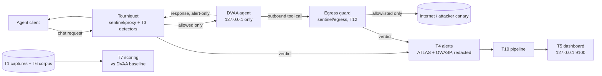

# Tourniquet

**An exfil-focused guardrail for tool-using agents: one pre-forward check, default-deny egress at the tool boundary, and alerting.**

*Why the name:* A tourniquet stops the bleed: Tourniquet stops data exfiltration (the "bleed") and other agent tool-misuse vulnerabilities at the egress boundary.

CrowdStrike x Santa Clara University hackathon, Track 3. Tourniquet sits between an AI agent and its
model and tools. It turns an indirect prompt injection that tries to exfiltrate data or misuse a tool into an AIDR-shaped alert, mapped to MITRE
ATLAS and OWASP, and it is designed to block exfil before forwarding or at egress. It does not block everything it catches: in our
corpus it detects 128 of 189 attacks and prevents 79, including 57 of 71 exfil attempts with 0 of 164 legitimate requests blocked (DVAA's own scanner prevents 64 of 71 but blocks 21 of 164). We complement Falcon AIDR at the tool
boundary; we have not integrated with it. Our target is **DVAA** (Damn
Vulnerable AI Agent), the organizers' intentionally vulnerable training sandbox, run offline on
`127.0.0.1`. **Deterministic sandbox, no LLM:** DVAA answers with canned responses, so nothing here has been tested
against a live model that paraphrases, splits or encodes its exfil. This is an authorized hackathon project, and all
of the work is defensive.

**Scope.** Tourniquet is designed to stop prompt-injection-driven *exfiltration and tool misuse*; it prevents 57 of 71 exfil attempts in our corpus, with 0 of 164 legitimate requests blocked; DVAA's own scanner prevents 64 of 71 but blocks 21 of 164. Generic jailbreak text with no action is out of scope for blocking (alerted at most); pair it with a jailbreak classifier such as Prompt Guard.

## The problem

> "AI is rewriting the enterprise attack surface at breakneck speed. Each prompt becomes an entry point
> for the adversary." (George Kurtz, CEO & founder, CrowdStrike)

An agent with tools is a **confused deputy** (Hardy, "The Confused Deputy", ACM SIGOPS OSR 22(4):36–38,
1988). It acts with the user's authority, but it takes instructions from any text it reads. In an
**indirect prompt injection** (Greshake et al., "Not What You've Signed Up For", AISec '23), the attack
arrives inside a tool result or a retrieved document, not from the user. The agent then sends private data
to the attacker. Simon Willison calls this the "lethal trifecta": private data, untrusted content, and
external communication (Jun 2025). OWASP lists it as LLM01 Prompt Injection and LLM02 Sensitive Information
Disclosure. It is also ASI01 Agent Goal Hijack and ASI02 Tool Misuse in the OWASP Top 10 for Agentic
Applications 2026. All pitch wording comes from [`planning/CITATIONS.md`](planning/CITATIONS.md).

## Where data actually leaves

Our honest headline, from [`sentinel/scoring/RESULTS.md`](sentinel/scoring/RESULTS.md):

- **Regex detection is not enough, and we have the numbers to prove it.** On the blended 353-case corpus, DVAA's own
  scanner prevents more than we do (63.0% against our 41.8%), at a 12.8% benign FP rate (21/164).
- **Where data actually leaves, we prevent 57/71 exfil positives with 0/164 legitimate requests blocked; DVAA prevents
  64/71 but blocks 21/164.** DVAA still prevents more there; the trade is false blocks. Most of the
  blended gap is injection-only text that steals nothing (we prevent 18.6% of it, DVAA 46.6%).
- **One pre-forward rule does all of our scored prevention.** All 79 prevented positives fire
  `inbound.exfil_instruction`. Honeytokens, provenance and taint are tripwires and alerts. The honeytokens are DVAA's
  own known secrets, so read them as a known-secret tripwire, not planted canaries.
- **The control that actually blocks is default-deny egress at the tool boundary.** It decides on the destination
  host, not on content, so it still denied every non-allowlisted destination we tried when the request-side rule was bypassed (spacing, homoglyphs). It is not scored on an attack set, and exfil to an allowlisted host is not covered; a second critic
  confirmed this live (issue #112). It also stops the RepoBot exfil that happens inside the agent, where no
  request-side check can reach (recorded run in `demo/captures/egress-demo-block.txt`).
- **Benign:** 0 of 164 benign cases blocked, on a benign set the rules were also tuned on. That is a small sample,
  not a zero-FP guarantee, and we don't headline it.

**We attacked ourselves.** On 600 held-out public jailbreak and injection rows we never tuned on, T3 detected 28.5%
and prevented **0%** ([`captures/holdout-hf/RESULTS.md`](captures/holdout-hf/RESULTS.md)). On held-out indirect injections
that do name destinations (LLMail-Inject + BIPIA), T3 prevented 3.2% against DVAA's 51.4% ([`captures/holdout-ipi/RESULTS.md`](captures/holdout-ipi/RESULTS.md)).
Our own critics (issue #112) also found that the **request-side rule is bypassable**: spacing out an account number
(`U S 1 3 3 0 ...`) or using homoglyphs slips past it. PR #122 (merged) now normalizes spacing, invisible characters and
mixed-script homoglyphs before matching; the blocking verbs
are English only. We make no request-side robustness claim. **Residual risk at egress:** exfil to a host the operator
has allowlisted, including an HTTPS CONNECT to an allowlisted host, where TLS is opaque and only the host is checked.

## The enforcement points

1. **Request-side proxy** ([`sentinel/proxy`](sentinel/proxy), with the T3 detectors in
   [`sentinel/detectors`](sentinel/detectors)). It is a reverse proxy in front of the agent's
   OpenAI-compatible `/v1/chat/completions`. It scans the **full** payload, with no 8KB window, for
   honeytokens (including encoded forms), destination provenance (did the user or system turns
   authorize this destination, or did it come only from untrusted tool output?), taint flow and secret shapes. It fails closed and **blocks before the request is forwarded**,
   so the agent never acts on it.
2. **Egress guard at the tool boundary** ([`sentinel/egress`](sentinel/egress), T12, PR #45). It is a forward
   proxy on an internal Docker network whose only exit is the guard. Every outbound tool call is decided
   **before it leaves**: honeytoken match, an exact-host allowlist, and fail-closed handling of oversize or
   over-encoded payloads. This is what stops attacks that the agent reads inside its own process, such as a
   poisoned `AGENTS.md`.

## Architecture



More detail is in [`docs/ARCHITECTURE.md`](docs/ARCHITECTURE.md).

## Quickstart

You need Node 22 or newer (24 preferred; Path A, `track3a/`, needs Node 24 or newer and exits 2 on older Node), Docker with compose v2, git, curl and python3. No API keys are
needed and no LLM is called.

```bash
scripts/eval.sh doctor    # check the tools and the pinned DVAA checkout; every FAIL prints a fix
scripts/eval.sh up        # start the DVAA fleet, bound to 127.0.0.1 only
scripts/eval.sh all       # doctor, up, test, score, contrast, dashboard, then a summary table
demo/run-demo.sh --auto   # the deterministic demo, every beat back to back
scripts/egress-demo.sh both   # egress guard live: observe (exfil lands), then block (prevented)
```

- [`EVAL.md`](EVAL.md) explains what each step shows and how to fix failures.
- [`CHAT.md`](CHAT.md) explains how to ask the team's orchestrator agent a question through GitHub Issues.
- **Demo videos:** [`demo/videos/`](demo/videos/README.md) — offline screen recordings (Track 3 Tourniquet, Track 3 Path A OpsBot, and the "403 that lied" encore), with an index of SHA, duration and what each one shows.

## Results

The current numbers are in **[`sentinel/scoring/RESULTS.md`](sentinel/scoring/RESULTS.md)**, which is
regenerated from the committed corpus by `scripts/eval.sh score`. We don't copy figures into this README,
so it can't go stale. How to read them:

- **Two lenses.** *Detection* asks whether we raised the right alert. *Prevention* asks whether the
  exfiltration was actually stopped. We report both separately, because an alert-only check detects but
  does not prevent.
- **Benign false positives.** The 0 of 164 benign blocked is on the 164-case benign corpus (which the rules were
  also tuned on, so it is not a zero-FP guarantee), the same corpus the
  DVAA baseline detector is scored on, so the comparison is like for like. Held-out benign: 1/32 blocked (a security-awareness memo quoting an injection phrase; same as before #46), and 4/32 raise an alert without a block. Held-out attacks: 14 of 16 hand-written paraphrases detected, but on an independent reviewer's 6 further paraphrases, 1 detected, so recall on novel phrasings is limited — see PR #46.
- **Recall.** Tourniquet's detection recall is now slightly above DVAA's baseline, but the baseline has
  the higher prevention recall, at a 12.8% benign FP rate (figures in RESULTS.md). We do not claim to beat it on
  prevention.
- **The 8KB window.** DVAA's own scanner looks only at the head and tail 8KB of a payload. Injections
  placed in the middle of a long benign document evade it. Tourniquet scans the full payload and catches
  2/2 of the `evadesBaseline` cases in the corpus. That is n=2, against a weakness DVAA built in on purpose, so we
  don't treat it as a differentiator.

## Honest limitations

- **DVAA runs its tools in-process.** The request-side proxy therefore cannot stop an action decided inside
  the agent, so response-side checks are **alert-only** for prevention (in block mode they withhold the reply,
  but the tool has already run). Prevention happens at two points: before the request is forwarded, and at the
  egress guard.
- **Observe vs block mode.** In `observe` mode the proxy is fail-open with an ALERT: an inspector error or
  timeout, or a body it cannot decode, is forwarded uninspected and alerted. In `block` mode the same cases are
  fail-closed (refused). The egress guard denies its fail-closed codes in both modes.
- **Known redaction gaps in T4 alert redaction** (listed in PR #12). A card number that follows another
  short digit group can pass unredacted. Double %-encoded and `\u`-escaped canaries can leak into alert
  text. The egress guard decodes these forms for its *blocking* decision, but alert redaction does not.
- **Egress guard scope** (T12). It does not intercept HTTPS: CONNECT is decided by host only. Egress events
  are linked to chat turns by best-effort time-window attribution only, and are reported standalone when the
  match is ambiguous. In-container loopback SSRF never reaches it.
- **Generic jailbreaks are out of scope for blocking.** On a held-out set of 600 attack and 400 benign cases from 3 public Hugging Face sets of generic jailbreaks and injections, T3 detected 28.5% and prevented 0%, with 0/400 false positives (detection by set: Gandalf 58%, SPML 19%, jailbreak-classification about 8%); DVAA detected and prevented 60.7%, with 22/400 (5.5%) false positives. Held-out; see [`captures/holdout-hf/RESULTS.md`](captures/holdout-hf/RESULTS.md).
- Detection is deterministic: honeytokens, taint, provenance and pattern rules, with no ML classifier.
  An injection that never attempts exfiltration may be flagged without being blocked.

## Track 1: SOC Brief (separate repo)

Our Track 1 entry, **SOC Brief**, lives in its own repository:
[MoAlborati/Tourniquet-SOC-Brief-Track1](https://github.com/MoAlborati/Tourniquet-SOC-Brief-Track1). It is
**deterministic by design; the LLM can only reword** — rules decide every verdict and the optional LLM may rewrite
the wording but can never lower a priority, so it cannot talk an alert down. This repo keeps the **Tourniquet → SOC
Brief handoff** ([`scripts/soc-handoff.sh`](scripts/soc-handoff.sh)), which briefs Tourniquet's real T4 alerts
offline using a vendored copy of the SOC Brief core ([`scripts/lib/vendor/soc-brief/`](scripts/lib/vendor/soc-brief/)).

## Repo map

| Path | What |
|---|---|
| `sentinel/proxy` | T2 reverse proxy: bounded, fail-loud, observe or block mode |
| `sentinel/egress` | T12 egress guard: forward proxy at the tool boundary, exact-host allowlist |
| `sentinel/detectors` | T3 detectors: honeytokens, provenance, full-payload fail-closed scan |
| `sentinel/alerts` | T4 alert schema, ATLAS/OWASP mapping, redaction |
| `sentinel/pipeline` | T10 wiring: proxy verdicts → T4 alerts → dashboard sink |
| `sentinel/dashboard` | T5 dashboard: deterministic replay, incident graph, alert feed |
| `sentinel/scoring` | T7 harness: precision, recall, benign FP rate, latency, override rates |
| `captures/` | T1 exploit transcripts, T6 attack and benign corpus, T8 secure-by-design contrast |
| `demo/` | T9 demo runner, script, deck, rehearsal log |
| `scripts/` | `eval.sh` (one-command evaluation and merge gate), DVAA setup, capture |
| `planning/` | Strategy, research, verified citations, T3 spec, egress design notes |
| `GOAL.md`, `BACKLOG.md`, `STATE.md` | Definition of Done, tickets T1–T12, live loop state |
| `LOOP.md`, `AGENTS.md`, `gates/`, `prompts/` | How the agent team builds this: PR-gated loop, roles, quality gates |

**How it was built.** An orchestrator agent dispatched child agents, one branch and one PR per ticket.
Each PR passed SE, tester, reviewer and delivery gates (`gates/`) and the merge gate
`scripts/eval.sh gate <PR#>`, then a human or agent reviewer merged it. See [`LOOP.md`](LOOP.md).

## Contributing / harness

Agent harness: cold-start runbook [`RESUME.md`](RESUME.md) and reusable agent roles [`prompts/archetypes/`](prompts/archetypes/README.md).

## Provenance and licensing

- Every **attack** string in the corpus is copied **verbatim** from a published benchmark or from DVAA,
  pinned to an upstream commit with its exact locator and sha256. `captures/variants/tools/verify-upstream.mjs`
  re-checks them. We wrote only benign material.
- Sources and licenses: deepset/prompt-injections (Apache-2.0), AgentDojo (MIT), InjecAgent (MIT) and DVAA
  (Apache-2.0, OpenA2A). Copied DVAA code keeps its SPDX header and notice. The full table is in
  [`captures/variants/LICENSES.md`](captures/variants/LICENSES.md).
- Exfiltration destinations are the benchmarks' own static values or a local `127.0.0.1` canary. No real
  secrets are used, and nothing is sent off the machine.
- This repository does not have a top-level license file yet. Third-party content stays under its upstream
  license.

## Credits

- **Team:** Shruti Doshi, Mo Alborati and Catherine ([@c-awad](https://github.com/c-awad), presenter), with an Opus 5.5 agent team (orchestrator plus implementer,
  tester and reviewer agents).
- **Target:** DVAA (Damn Vulnerable AI Agent) by OpenA2A, provided by the organizers.
- **Benchmarks:** AgentDojo (Debenedetti et al., NeurIPS 2024), InjecAgent (Zhan et al., ACL Findings
  2024) and deepset/prompt-injections.
- **Hosts:** CrowdStrike and Santa Clara University.
